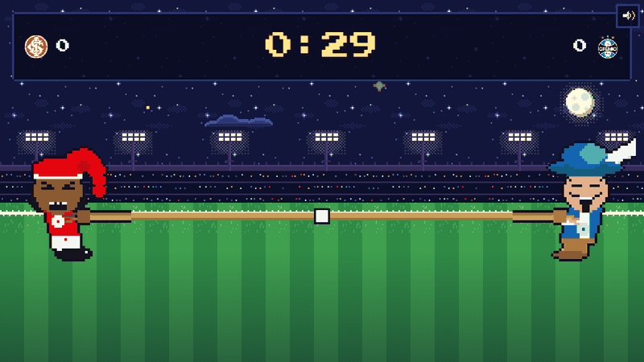
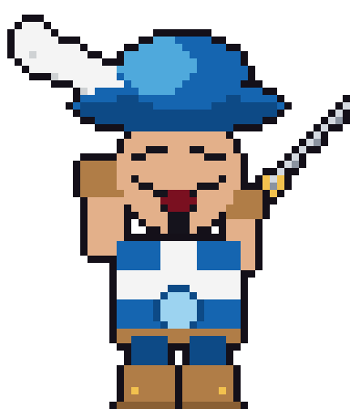
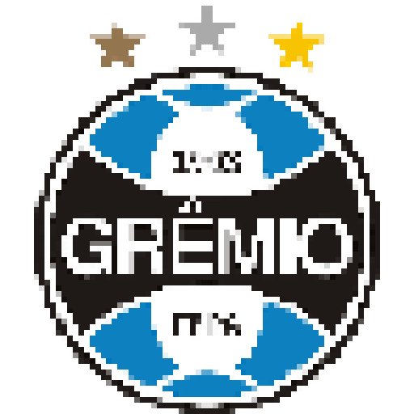
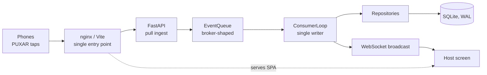

<div align="center">


# Corda Brava

**A pixel-art tug-of-war party game: Inter vs Grêmio, one tap at a time.**




</div>

## The mascots and crests

<div align="center">

| Saci (Inter) | Mosqueteiro (Grêmio) | Inter crest | Grêmio crest |
|:---:|:---:|:---:|:---:|
|  |  |  |  |

</div>

*All mascots and crests are owner-authored art files; the app only displays them.*

## What it is

A host opens a big screen (a TV or projector) and shows a QR code. Players scan it with their phones, enter a name,
pick **Inter** (red) or **Grêmio** (blue/black) and tap the **PUXAR** button as fast as they can. Every tap tugs a
rope live on the host screen, between two pixel-art mascots. The first team to drag the rope all the way to their
side wins; if time runs out, it is a draw (*empate*). The host screen then shows a celebration and match analytics.

This is a private fan party game, not a commercial product. Player-facing text is Brazilian Portuguese (PT-BR);
code, identifiers and comments are English.

## Features

- Host login (password + JWT), match creation with 30-600 s duration and selectable scoring.
- Lobby with a QR code and a live, animated roster; one player per device, late join blocked by default.
- Mobile-first player flow: Join, Wait, Play (PUXAR), End, with session restore on reload.
- Live rope scene with an interpolated knot, a server-authoritative timer and chiptune sound effects.
- Results screen with analytics: timeline, peak moments, best/worst players, team percentages, leaderboard.
- Batched taps with idempotent retries, a per-player anti-cheat rate cap and flush-on-hide.
- Broker-shaped event queue: in memory by default, or Azure Service Bus with one env var (`QUEUE_BACKEND=azure_service_bus`).
- Single-port Docker deployment (nginx serves the SPA and proxies the API and WebSocket).

## Architecture



- **Domain rules.** The rope lives in `[-ROPE_TARGET, +ROPE_TARGET]` with `0` at the center; negative is Inter
  (left), positive is Grêmio (right). Scoring defaults to `normalized` (per-player intensity, fair for uneven teams);
  `raw` is selectable. The pure rules are in `backend/app/domain/rules.py` and have no IO or framework dependencies.
- **Idempotency.** Clients send taps in batches with a `batchId`. The ingest endpoint answers `202` and dedups by
  `batchId`, so a retried batch never counts twice. The queue itself is at-least-once (leased receive, explicit ack,
  redelivery of unacked batches), and the consumer is safe against redelivery.
- **Azure Service Bus.** `AzureServiceBusEventQueue` (`backend/app/queue/azure_service_bus.py`) implements the same
  `EventQueue` Protocol, so the consumer, services and domain are untouched; `QUEUE_BACKEND=azure_service_bus`
  selects it. See [Azure Service Bus](#azure-service-bus) below.
- **Scaling limit.** Run one process, one worker. The match registry and batch dedup are per-process (and so is the
  in-memory queue), so multiple workers or replicas would split a match's state. Scaling out needs shared state on
  top of the Azure queue, which is out of scope.

Design rationale: [`docs/superpowers/specs/2026-11-03-corda-brava-design.md`](./docs/superpowers/specs/2026-11-03-corda-brava-design.md).

## Tech stack

| Layer | Technology |
|---|---|
| Backend | Python 3.11+, FastAPI, pydantic-settings, SQLite (WAL) behind repository Protocols |
| Frontend | React 18, TypeScript, Vite, React Router, Recharts, qrcode.react, Press Start 2P |
| Tests | pytest, Vitest, Playwright |
| Deploy | Docker Compose, nginx |

## Project structure

```
corda-brava/
├── prompt.md                  # authoritative spec
├── backend/
│   ├── app/
│   │   ├── api/               # player, host, auth, WebSocket routes
│   │   ├── core/              # settings, app factory, logging
│   │   ├── domain/            # entities, enums, pure game rules
│   │   ├── queue/             # EventQueue Protocol, in-memory and Azure Service Bus impls, factory
│   │   ├── repositories/      # interfaces + SQLite implementations
│   │   ├── schemas/           # request/response models
│   │   └── services/          # match service, consumer loop, registry, analytics, sessions
│   └── tests/
├── frontend/
│   ├── src/                   # pages, components, hooks, api client, theme, pixel assets
│   ├── e2e/                   # Playwright end-to-end flow
│   ├── scripts/               # record-readme-gif.mjs
│   └── nginx.conf
├── docs/
│   ├── logo-references/       # owner-authored club crests
│   ├── mascot-references/     # owner-authored mascot sprites
│   ├── readme/                # README media
│   └── superpowers/           # spec, plan, SDD progress ledger
├── docker-compose.yml
├── docker-compose.dev.yml
└── .env.example
```

## Getting started

### Local development

```bash
# backend (:8000) - see backend/README.md
cd backend
python -m venv .venv && source .venv/bin/activate    # Windows: .venv\Scripts\activate
pip install -e ".[dev]"
uvicorn app.core.app_factory:create_app --factory --reload

# frontend (:5173, proxies /api and WebSocket)
cd frontend
npm install
npm run dev
```

Open <http://localhost:5173/host/login>. The host password is set by `HOST_PASSWORD`
(see `backend/app/core/settings.py` for the dev default).

### Docker (production, single port)

```bash
cp .env.example .env     # set HOST_PASSWORD and SECRET_KEY
# python -c "import secrets; print(secrets.token_hex(32))"
docker compose up -d --build
```

Open `http://<host>/`. SQLite lives on a named volume.

### Docker (dev, hot reload)

```bash
docker compose -f docker-compose.yml -f docker-compose.dev.yml up --build   # needs Compose >= 2.24
```

### LAN play and the QR code

Phones cannot open `localhost`. Set `PUBLIC_BASE_URL` and `VITE_PUBLIC_BASE` in `.env` to `http://<LAN-IP>`
(append `:PORT` if `PUBLIC_PORT` is not 80) before building, so the QR code points at an address phones can reach.

## Azure Service Bus

By default the pulls travel through an in-memory queue. To send them through Azure Service Bus instead:

1. **Namespace.** Create a Service Bus namespace (tested on Standard). In the portal open it, then *Settings,
   Shared access policies, RootManageSharedAccessKey* and copy the **Primary connection string** (namespace-level,
   without `EntityPath`).
2. **Configure** the repo-root `.env`, which Docker Compose reads (a local `uvicorn` reads `backend/.env` instead;
   see [Configuration](#configuration)):

   ```bash
   QUEUE_BACKEND=azure_service_bus
   AZURE_SERVICEBUS_CONNECTION_STRING="Endpoint=sb://<namespace>.servicebus.windows.net/;SharedAccessKeyName=RootManageSharedAccessKey;SharedAccessKey=<key>"
   AZURE_SERVICEBUS_QUEUE_NAME=corda-brava-pulls
   ```

3. **Create the queue once** (idempotent; needs Manage rights, the running app only needs Send + Listen):

   ```bash
   cd backend && python -m app.queue.provision
   ```

   It creates the queue with a lock of `QUEUE_LEASE_TIMEOUT_S` (10 s by default, the same lease as the in-memory
   queue), max delivery count 10, a 1 h message TTL and 10 min duplicate detection. Run it again on an existing queue
   and it checks it: lock, max delivery count, TTL and duplicate-detection window are updated in place, while a queue
   without duplicate detection or with sessions is reported as an error, because those cannot be changed after
   creation (delete the queue and run it again). The same settings work from the portal or `az servicebus queue create`.
4. **Run the app as usual.** On startup the log shows `Azure Service Bus queue 'corda-brava-pulls' ready on <namespace>`;
   a wrong key, a missing queue or an unreachable network stops the app right there (after the SDK's
   retries, up to ~15 s) instead of on the first pull.

How the `EventQueue` contract maps onto the broker:

| `EventQueue` | Azure Service Bus |
|---|---|
| `enqueue` | one task owns the sender and group-commits whatever piled up as a `ServiceBusMessageBatch`; `message_id` is `<matchId>:<batchId>` |
| `receive_batch` | `receive_messages` in PEEK_LOCK with `prefetch_count=0`; callers that poll while a receive is in flight join it, then take up to `max_messages` from a local pool of locked messages |
| `ack` | `complete_message`, settled in parallel |
| `abandon` | the message, still locked, goes back to the local pool for the next `receive_batch`; the broker is not told, so the delivery count does not grow (`abandon_message` would count as a delivery attempt) |
| lease timeout | the queue's `LockDuration`, set by `provision` from `QUEUE_LEASE_TIMEOUT_S`; a pooled message whose lock is about to run out is left to the broker, which redelivers it |
| redelivery | the broker re-queues an unsettled message when its lock expires; `delivery_count` is the broker's count plus one |
| unparseable message | dead-lettered with reason `invalid-payload` (browse `corda-brava-pulls/$deadletterqueue` in Service Bus Explorer) |

Things worth knowing (measured on a Standard namespace, about 54 ms from the dev machine):

- **The SDK is picky about concurrency.** 50 concurrent sends on one sender made 49 fail, two concurrent receives on one
  receiver interfere, and each `complete` waits for the broker (50 sequential completes took 7.4 s, 100 in parallel
  0.26 s). That is why sends are group-committed, why match loops that poll at the same time share one receive
  instead of queueing one each, and why settles run in parallel (never during a receive: the SDK receiver is not
  coroutine-safe).
- **Ticks arrive about every 0.7 s instead of 0.5 s.** `receive_messages` takes at least ~0.2 s even on an empty queue,
  and the consumer sleeps `TICK_INTERVAL_MS` between polls. The host screen interpolates, so it is barely visible.
- **A failed send is a `503`.** The pull route only remembers a `batchId` after the broker accepted it, and the client
  already resends 5xx batches with the same `batchId`, so an outage loses no pulls. A resend that arrives while the
  first send is still in flight waits for that send and gets its answer; it is not sent again.
- **Duplicates are absorbed three times**: the route's `batchId` memory, the broker's duplicate detection and the
  consumer's `batchId` check (a crash between apply and ack redelivers the message, which is then acked without effect).
- **Simultaneous matches share the queue.** Each match loop hands back the pulls of the other running matches with
  `abandon`, which stays inside the process (see the table), so those pulls are neither delayed by a lock nor
  dead-lettered. The pool is per process, which fits the single-worker backend.
- **One backend per queue.** A second backend on the same queue (for example a local `uvicorn` next to the Docker
  stack) takes messages for matches it does not know and drops them. Give it its own queue or the memory backend.
- **Network.** The SDK speaks AMQP over TLS (outbound TCP 5671). Networks that block it, such as some campus Wi-Fi,
  cannot reach the queue; AMQP over WebSockets (port 443) is not wired up.
- **Cost.** A Standard namespace bills a base fee while it exists; delete it when you are done.

## Configuration

Set in `.env` (see `.env.example`); defaults live in `backend/app/core/settings.py`. Docker Compose reads the
repo-root `.env`. A local `uvicorn` reads only `backend/.env` (plus real environment variables) from wherever it is
started, so it never picks up the Docker values (LAN `PUBLIC_BASE_URL` on port 80, the shared Azure queue, the stack's
secrets). `python -m app.queue.provision` and the opt-in Azure tests read both files (`backend/.env` wins), because
the connection string usually lives in the root one.

| Variable | Default | Purpose |
|---|---|---|
| `HOST_PASSWORD` | `change-me` in `.env.example` | Host login password (required in Docker) |
| `SECRET_KEY` | random in dev | JWT signing key (required in Docker) |
| `PUBLIC_PORT` | `80` | Host port of the nginx entry point |
| `PUBLIC_BASE_URL` / `VITE_PUBLIC_BASE` | `http://localhost` | Origin encoded in the QR code |
| `CORS_ORIGINS` | `*` | Allowed origins; restrict in production |
| `DATABASE_URL` | `sqlite:///./corda_brava.db` | Database location |
| `TICK_INTERVAL_MS` | `500` | Rope update and broadcast interval |
| `DEFAULT_MATCH_DURATION_S` | `120` | Default match length (min 30, max 600) |
| `ROPE_TARGET` | `100` | Rope distance needed to win |
| `MAX_PULLS_PER_PLAYER_PER_S` | `50` | Per-player anti-cheat cap |
| `LATE_JOIN_POLICY` | `block` | `block` or `spectator` |
| `TEAM_BALANCE_MODE` | `normalized` | `normalized` or `raw` scoring |
| `QUEUE_BACKEND` | `memory` | `memory` or `azure_service_bus` |
| `QUEUE_LEASE_TIMEOUT_S` | `10` | Lease of a received message: the in-memory timeout and the Service Bus queue's lock (5-300 s; re-run `provision` after changing it) |
| `AZURE_SERVICEBUS_CONNECTION_STRING` | unset | Namespace-level connection string; required for `azure_service_bus` |
| `AZURE_SERVICEBUS_QUEUE_NAME` | unset | Queue name (create it with `python -m app.queue.provision`); required for `azure_service_bus` |

## Testing

```bash
cd backend && python -m pytest        # 205 tests (+6 opt-in against a real Azure namespace)
cd frontend && npm test -- --run      # 80 tests (Vitest)
cd frontend && npx playwright install chromium && npm run e2e
```

The Azure tests are skipped unless asked for. They create and delete their own temporary queues (`cb-test-*`) in the
namespace from the root `.env` (or `backend/.env`), never the app's queue:

```bash
cd backend && AZURE_TESTS=1 python -m pytest tests/queue/test_azure_service_bus_integration.py -v
```

The adapter is otherwise tested against an in-process fake broker that reproduces the SDK behaviours above, and the
unchanged `ConsumerLoop` is run on top of it (`tests/queue/test_azure_consumer_swap.py`). Tests never read a `.env`.

The Playwright e2e drives a host and a player in separate browser contexts (login, create, join, start, pull,
results) against a running stack; set `E2E_BASE_URL=http://localhost` to target the Docker stack.

## Deployment (VPS, TLS, wss)

Run the Docker stack on the VPS and put a TLS-terminating reverse proxy (Caddy, Traefik, or nginx + certbot) in
front of port 80, forwarding with WebSocket upgrade headers. Set `PUBLIC_BASE_URL` and `VITE_PUBLIC_BASE` to
`https://<your-domain>`. API and WebSocket URLs derive from the page origin, so they become `https://` / `wss://`
automatically; leave `VITE_API_BASE` and `VITE_WS_BASE` empty. Restrict `CORS_ORIGINS` to your origin.

## Art and assets policy

The two mascots, Inter's **Saci** and Grêmio's **Mosqueteiro**, and the club crests are image files authored and
committed by the project owner (under `docs/mascot-references/.../assets/` and `docs/logo-references/`). The
application copies and displays those files; **no code draws, generates or renders the club mascots or crests**.
This is a deliberate deviation from `prompt.md` section 1, which asks for them to be drawn in code. If you extend the
art, add original assets or original characters, and never write code that renders the club mascots or crests.

## How it was built

Built task by task with subagent-driven development: each of the 18 plan tasks was implemented by a subagent
(TDD), then checked by a separate reviewer before moving on. See the
[plan](./docs/superpowers/plans/2026-11-03-corda-brava.md) and the
[progress ledger](./docs/superpowers/sdd/2026-11-03-corda-brava/progress.md).

**Status:** all 18 plan tasks and the visual polish phase are done: pixel design system, animated stadium
scene, chiptune SFX, title/lobby/match/results screens and the phone screens. Local dev and the Playwright e2e were verified against the Vite stack; the Docker
setup was run on macOS (Apple Silicon) with `QUEUE_BACKEND=azure_service_bus`: build, healthcheck and a full match
through nginx, WebSocket proxy included. Docker with the default in-memory queue has not been run.
