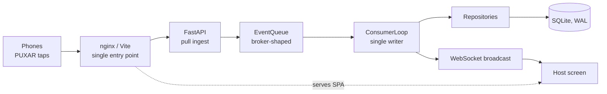

<div align="center">


# Corda Brava

**A pixel-art tug-of-war party game: Inter vs Grêmio, one tap at a time.**


</div>

## The mascots and crests

<div align="center">

| Saci (Inter) | Mosqueteiro (Grêmio) | Inter crest | Grêmio crest |
|:---:|:---:|:---:|:---:|
|  |  |  |  |

</div>

*All mascots and crests are owner-authored art files; the app only displays them.*

## What it is

A host opens a big screen (a TV or projector) and shows a QR code. Players scan it with their phones, enter a name,
pick **Inter** (red) or **Grêmio** (blue/black) and tap the **PUXAR** button as fast as they can. Every tap tugs a
rope live on the host screen, between two pixel-art mascots. The first team to drag the rope all the way to their
side wins; if time runs out, it is a draw (*empate*). The host screen then shows a celebration and match analytics.

This is a private fan party game, not a commercial product. Player-facing text is Brazilian Portuguese (PT-BR);
code, identifiers and comments are English.

## Features

- Host login (password + JWT), match creation with 30-600 s duration and selectable scoring.
- Lobby with a QR code and a live, animated roster; one player per device, late join blocked by default.
- Mobile-first player flow: Join, Wait, Play (PUXAR), End, with session restore on reload.
- Live rope scene with an interpolated knot, a server-authoritative timer and chiptune sound effects.
- Results screen with analytics: timeline, peak moments, best/worst players, team percentages, leaderboard.
- Batched taps with idempotent retries, a per-player anti-cheat rate cap and flush-on-hide.
- Broker-shaped event queue, ready to be swapped for Azure Service Bus.
- Single-port Docker deployment (nginx serves the SPA and proxies the API and WebSocket).

## Architecture



- **Domain rules.** The rope lives in `[-ROPE_TARGET, +ROPE_TARGET]` with `0` at the center; negative is Inter
  (left), positive is Grêmio (right). Scoring defaults to `normalized` (per-player intensity, fair for uneven teams);
  `raw` is selectable. The pure rules are in `backend/app/domain/rules.py` and have no IO or framework dependencies.
- **Idempotency.** Clients send taps in batches with a `batchId`. The ingest endpoint answers `202` and dedups by
  `batchId`, so a retried batch never counts twice. The queue itself is at-least-once (leased receive, explicit ack,
  redelivery of unacked batches), and the consumer is safe against redelivery.
- **Azure Service Bus swap.** Add `backend/app/queue/azure_service_bus.py` with an `AzureServiceBusEventQueue`
  implementing the `EventQueue` Protocol, add one `elif` in `queue/factory.py`, and set
  `QUEUE_BACKEND=azure_service_bus`. No consumer, service or domain changes are needed. Until the adapter exists,
  the factory raises `NotImplementedError`.
- **Scaling limit.** Run one process, one worker. The in-memory queue, match registry and batch dedup are
  per-process, so multiple workers or replicas would split a match's state. Scaling out needs the Azure queue plus
  shared state, which is out of scope.

Design rationale: [`docs/superpowers/specs/2026-11-03-corda-brava-design.md`](./docs/superpowers/specs/2026-11-03-corda-brava-design.md).

## Tech stack

| Layer | Technology |
|---|---|
| Backend | Python 3.11+, FastAPI, pydantic-settings, SQLite (WAL) behind repository Protocols |
| Frontend | React 18, TypeScript, Vite, React Router, Recharts, qrcode.react, Press Start 2P |
| Tests | pytest, Vitest, Playwright |
| Deploy | Docker Compose, nginx |

## Project structure

```
corda-brava/
├── prompt.md                  # authoritative spec
├── backend/
│   ├── app/
│   │   ├── api/               # player, host, auth, WebSocket routes
│   │   ├── core/              # settings, app factory, logging
│   │   ├── domain/            # entities, enums, pure game rules
│   │   ├── queue/             # EventQueue Protocol, in-memory impl, factory
│   │   ├── repositories/      # interfaces + SQLite implementations
│   │   ├── schemas/           # request/response models
│   │   └── services/          # match service, consumer loop, registry, analytics, sessions
│   └── tests/
├── frontend/
│   ├── src/                   # pages, components, hooks, api client, theme, pixel assets
│   ├── e2e/                   # Playwright end-to-end flow
│   ├── scripts/               # record-readme-gif.mjs
│   └── nginx.conf
├── docs/
│   ├── logo-references/       # owner-authored club crests
│   ├── mascot-references/     # owner-authored mascot sprites
│   ├── readme/                # README media
│   └── superpowers/           # spec, plan, SDD progress ledger
├── docker-compose.yml
├── docker-compose.dev.yml
└── .env.example
```

## Getting started

### Local development

```bash
# backend (:8000) - see backend/README.md
cd backend
python -m venv .venv && source .venv/bin/activate    # Windows: .venv\Scripts\activate
pip install -e ".[dev]"
uvicorn app.core.app_factory:create_app --factory --reload

# frontend (:5173, proxies /api and WebSocket)
cd frontend
npm install
npm run dev
```

Open <http://localhost:5173/host/login>. The host password is set by `HOST_PASSWORD`
(see `backend/app/core/settings.py` for the dev default).

### Docker (production, single port)

```bash
cp .env.example .env     # set HOST_PASSWORD and SECRET_KEY
# python -c "import secrets; print(secrets.token_hex(32))"
docker compose up -d --build
```

Open `http://<host>/`. SQLite lives on a named volume.

### Docker (dev, hot reload)

```bash
docker compose -f docker-compose.yml -f docker-compose.dev.yml up --build   # needs Compose >= 2.24
```

### LAN play and the QR code

Phones cannot open `localhost`. Set `PUBLIC_BASE_URL` and `VITE_PUBLIC_BASE` in `.env` to `http://<LAN-IP>`
(append `:PORT` if `PUBLIC_PORT` is not 80) before building, so the QR code points at an address phones can reach.

## Configuration

Set in `.env` (see `.env.example`); defaults live in `backend/app/core/settings.py`.

| Variable | Default | Purpose |
|---|---|---|
| `HOST_PASSWORD` | `change-me` in `.env.example` | Host login password (required in Docker) |
| `SECRET_KEY` | random in dev | JWT signing key (required in Docker) |
| `PUBLIC_PORT` | `80` | Host port of the nginx entry point |
| `PUBLIC_BASE_URL` / `VITE_PUBLIC_BASE` | `http://localhost` | Origin encoded in the QR code |
| `CORS_ORIGINS` | `*` | Allowed origins; restrict in production |
| `DATABASE_URL` | `sqlite:///./corda_brava.db` | Database location |
| `TICK_INTERVAL_MS` | `500` | Rope update and broadcast interval |
| `DEFAULT_MATCH_DURATION_S` | `120` | Default match length (min 30, max 600) |
| `ROPE_TARGET` | `100` | Rope distance needed to win |
| `MAX_PULLS_PER_PLAYER_PER_S` | `50` | Per-player anti-cheat cap |
| `LATE_JOIN_POLICY` | `block` | `block` or `spectator` |
| `TEAM_BALANCE_MODE` | `normalized` | `normalized` or `raw` scoring |
| `QUEUE_BACKEND` | `memory` | `memory` or `azure_service_bus` |

## Testing

```bash
cd backend && python -m pytest        # 154 tests
cd frontend && npm test -- --run      # 57 tests (Vitest)
cd frontend && npx playwright install chromium && npm run e2e
```

The Playwright e2e drives a host and a player in separate browser contexts (login, create, join, start, pull,
results) against a running stack; set `E2E_BASE_URL=http://localhost` to target the Docker stack.

## Deployment (VPS, TLS, wss)

Run the Docker stack on the VPS and put a TLS-terminating reverse proxy (Caddy, Traefik, or nginx + certbot) in
front of port 80, forwarding with WebSocket upgrade headers. Set `PUBLIC_BASE_URL` and `VITE_PUBLIC_BASE` to
`https://<your-domain>`. API and WebSocket URLs derive from the page origin, so they become `https://` / `wss://`
automatically; leave `VITE_API_BASE` and `VITE_WS_BASE` empty. Restrict `CORS_ORIGINS` to your origin.

## Art and assets policy

The two mascots, Inter's **Saci** and Grêmio's **Mosqueteiro**, and the club crests are image files authored and
committed by the project owner (under `docs/mascot-references/.../assets/` and `docs/logo-references/`). The
application copies and displays those files; **no code draws, generates or renders the club mascots or crests**.
This is a deliberate deviation from `prompt.md` section 1, which asks for them to be drawn in code. If you extend the
art, add original assets or original characters, and never write code that renders the club mascots or crests.

## How it was built

Built task by task with subagent-driven development: each of the 18 plan tasks was implemented by a subagent
(TDD), then checked by a separate reviewer before moving on. See the
[plan](./docs/superpowers/plans/2026-11-03-corda-brava.md) and the
[progress ledger](./docs/superpowers/sdd/2026-11-03-corda-brava/progress.md).

**Status:** all 18 plan tasks are done; the visual polish phase (pixel design system, animated stadium scene,
chiptune SFX) is still in progress. The Docker setup has not been run yet, because Docker was unavailable in the
build environment; local dev and the Playwright e2e were verified against the Vite stack.
